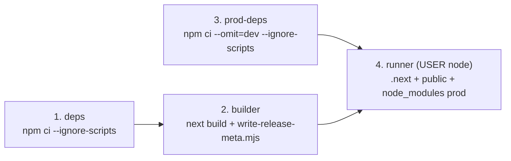

# Proceso de release reproducible · PWA de inspecciones de laboratorio (Semana 10)

> Tarea 1 (Cleber · matrícula 3523110321): empaquetado reproducible en contenedor, identidad verificable de versión y sonda de salud (`/api/health`). Todos los datos del proyecto son **sintéticos**.

## 1. Propósito y alcance

Este documento define cómo construir, identificar, verificar y promover una versión desplegable de la PWA de inspecciones de laboratorio de forma **reproducible y auditable**, garantizando que:

1. Cada unidad liberada se construya desde el archivo de bloqueo (`package-lock.json`) sin ejecutar scripts de instalación de terceros.
2. La versión en ejecución pueda consultarse en tiempo real mediante una sonda de salud (`GET /api/health` y `HEAD /api/health`) sin quedar atrapada en cachés intermedias ni en el Service Worker.
3. Ninguna credencial, llave privada ni archivo de entorno local entre al contexto de compilación ni a las capas de la imagen.

Los procedimientos de respuesta ante incidentes, reversión de contenedor y recuperación de clientes con Service Worker defectuoso se detallan de forma complementaria en `docs/runbook.md` (Tarea 2).

---

## 2. Esquema de versionado e identidad de la release

Cada compilación expone tres coordenadas verificables gestionadas por [`src/lib/release/version.ts`](../src/lib/release/version.ts) y generadas tras el build por [`scripts/write-release-meta.mjs`](../scripts/write-release-meta.mjs):

| Campo | Fuente | Formato exigido | Propósito |
| :--- | :--- | :--- | :--- |
| `version` | `package.json` (`version`) | SemVer estricto (`MAJOR.MINOR.PATCH`, opcional `-pre` / `+meta`) | Identifica funcionalmente el corte de la aplicación (`0.1.0`, `0.2.0`, etc.). |
| `revision` | `git rev-parse --short=12 HEAD` o `--build-arg APP_REVISION` | `^[A-Za-z0-9._-]{1,64}$` (respaldo `"local"`) | Enlaza de manera inmutable el contenedor o servidor en ejecución con el commit exacto evaluado. |
| `buildId` | `.next/BUILD_ID` | `^[A-Za-z0-9._-]{1,64}$` (respaldo `"dev"`) | Identifica artefactos compilados por Next.js en esa ejecución de `next build`. |

### Decisiones de diseño sobre los metadatos

- **Determinismo byte a byte en `.next/release-meta.json`.** [`scripts/write-release-meta.mjs`](../scripts/write-release-meta.mjs) no estampa marcas de tiempo variables (`Date.now()`) dentro del archivo generado: dos compilaciones sobre la misma revisión y `BUILD_ID` producen exactamente los mismos bytes.
- **Compatibilidad con el control de entorno de la Semana 9 (T-08).** En lugar de leer nuevas variables `process.env.*` o `NEXT_PUBLIC_*` dentro de `src/` —lo cual abriría la superficie revisada por la prueba de aislamiento de entorno en `tests/security.spec.ts`—, `write-release-meta.mjs` corre como paso posterior al build fuera de `src/` y deposita `.next/release-meta.json`. En tiempo de ejecución, [`readReleaseInfo()`](../src/lib/release/version.ts) lee únicamente archivos locales (`.next/release-meta.json`, `.next/BUILD_ID` y `package.json`) y `process.env.NODE_ENV`.
- **Saneamiento estricto.** Cualquier valor fuera de `^[A-Za-z0-9._-]{1,64}$` es rechazado con código de salida `1` durante la escritura de metadatos, o sustituido por su valor de respaldo (`"local"` / `"dev"`) al leerse.

---

## 3. Construcción reproducible en contenedor (`Dockerfile`)

El [`Dockerfile`](../Dockerfile) divide el ciclo en **cuatro etapas** sobre `node:20-bookworm-slim` (alineado con `.nvmrc` = `20` y `engines.node` de `package.json`):



### Trade-offs y justificación de ingeniería

| Decisión | Alternativa descartada | Motivo técnico y costo aceptado |
| :--- | :--- | :--- |
| **`node:20-bookworm-slim`** en las 4 etapas | `node:20-alpine` o `node:latest` | `latest` rompe la reproducibilidad entre días; `alpine` usa `musl` y puede alterar el comportamiento de binarios nativos de Next.js/Turbopack. `bookworm-slim` conserva `glibc` con huella reducida (~75 MB comprimidos). |
| **Etapa `prod-deps` independiente (`--omit=dev`)** | Copiar `node_modules` completo desde `deps` | Excluye Playwright, Vitest, ESLint, jsdom y TypeScript de la imagen final, reduciendo drásticamente tamaño y superficie de ataque en producción. |
| **Copia explícita de `scripts/lib/import-ts.mjs` en `runner`** | Eliminar `scripts/` por completo en `runner` | `next.config.mjs` tiene una importación estática superior hacia `./scripts/lib/import-ts.mjs`. Aunque `next start` no invoca `headers()` en tiempo de ejecución (usa `.next/routes-manifest.json`), Node resuelve el módulo importado al cargar `next.config.mjs`. Copiar ese único archivo ligero evita requerir `typescript` en producción. |
| **`CMD ["node", "node_modules/next/dist/bin/next", "start"]` con `USER node`** | `CMD ["npm", "start"]` como `root` | Invocar `node` directamente en formato *exec* sitúa a Next.js como PID 1 para recibir `SIGTERM` limpiamente durante un *rolling update* o *rollback*, sin procesos envolventes `sh`/`npm` y sin privilegios de superusuario. |
| **`.dockerignore` restrictivo** | Copiar todo el árbol con `COPY . .` | Bloquea `.git`, `.env*`, llaves (`*.pem`, `*.key`, `*.p12`), `node_modules`, `.next`, `tests/` y `reports/`, acelerando el envío del contexto e impidiendo que credenciales locales queden grabadas en capas intermedias. |

---

## 4. Sonda de salud (`/api/health` y `HEALTHCHECK`)

El endpoint [`src/app/api/health/route.ts`](../src/app/api/health/route.ts) implementa `GET` y `HEAD`:

- **Comprobaciones activas (`checks`):**
  1. `releaseMetadata`: verifica que la versión leída de `package.json` cumpla SemVer válido.
  2. `repository`: ejecuta una lectura real sobre el repositorio sintético de inspecciones (`listInspections`).
- **Códigos de estado:**
  - `200 OK` cuando ambas verificaciones están en `"ok"`.
  - `503 Service Unavailable` con `status: "degraded"` si falla el origen de datos (por ejemplo con `?simular=error` durante pruebas de regresión o simulacros) o si los metadatos de versión son inválidos, sin exponer trazas ni mensajes internos de excepción.
- **No cacheable por diseño:** responde con `Cache-Control: no-store` y `X-Content-Type-Options: nosniff`, queda cubierto por la regla `/api/:path*` de `next.config.mjs` y es ignorado por `public/sw.js` (`url.pathname.startsWith("/api/")`), asegurando que orquestadores y balanceadores observen siempre el estado real del proceso.
- **`HEALTHCHECK` nativo en `Dockerfile`:** ejecuta `fetch('http://127.0.0.1:3000/api/health')` con el propio binario `node` cada `30s` (`timeout=5s`, `start-period=15s`, `retries=3`), evitando instalar `curl` o `wget` dentro de la imagen mínima.

---

## 5. Procedimiento reproducible de compilación y liberación

### 5.1 Compuertas obligatorias previas (*Quality Gates*)

Antes de etiquetar o construir una imagen candidata, todas las comprobaciones deterministas deben terminar con código `0`:

```bash
npm ci --ignore-scripts --no-audit --no-fund
npm run lint
npm run typecheck
npm run build
node scripts/write-release-meta.mjs
npm test
```

### 5.2 Construcción y verificación con Docker

```bash
# 1. Obtener la revisión corta del commit evaluado y la versión de package.json
REV=$(git rev-parse --short=12 HEAD)
VER=$(node -p "require('./package.json').version")

# 2. Construir imagen reproducible etiquetada por SemVer y por revisión inmutable
docker build \
  --build-arg APP_REVISION="$REV" \
  -t "pwa-inspecciones:${VER}" \
  -t "pwa-inspecciones:sha-${REV}" \
  .

# 3. Arrancar contenedor aislado exponiendo el puerto 3000
docker run -d --rm --name pwa-inspecciones-check -p 3000:3000 "pwa-inspecciones:sha-${REV}"

# 4. Comprobar sonda de salud y coincidencia exacta de versión/revisión
curl -fsS -i http://127.0.0.1:3000/api/health

# 5. Detener el contenedor de prueba
docker stop pwa-inspecciones-check
```

### 5.3 Verificación equivalente sin demonio Docker local

En estaciones de trabajo donde Docker Desktop no esté instalado, el mismo artefacto de ejecución (`runner`) se comprueba localmente con:

```bash
npm ci --ignore-scripts --no-audit --no-fund
npm run build
node scripts/write-release-meta.mjs --revision "$(git rev-parse --short=12 HEAD)"
NODE_ENV=production node node_modules/next/dist/bin/next start -p 3000
# En otra terminal:
curl -fsS -i http://127.0.0.1:3000/api/health
```

---

## 6. Reglas de promoción y límites conocidos

- **Inmutabilidad de artefactos:** nunca se sobrescribe una etiqueta `sha-<commit>` ya publicada. Si una versión presenta fallos tras desplegarse, el contenedor se revierte a la etiqueta `sha-<commit-anterior>` previamente verificada y los clientes con Service Worker se recuperan siguiendo `docs/runbook.md`.
- **Persistencia de demostración:** el almacenamiento de `/api/inspecciones` en el servidor vive en memoria del proceso (diseño acumulado del curso); reemplazar o reiniciar el contenedor limpia las confirmaciones en memoria del servidor, mientras que las inspecciones pendientes no sincronizadas permanecen resguardadas en `IndexedDB` del navegador.
- **Imagen base por etiqueta menor:** `node:20-bookworm-slim` fija la línea mayor de Node acorde a `.nvmrc`; para fijar también parches del sistema operativo en entornos industriales se recomienda anclar adicionalmente el *digest* `sha256` al publicar en un registro interno.

