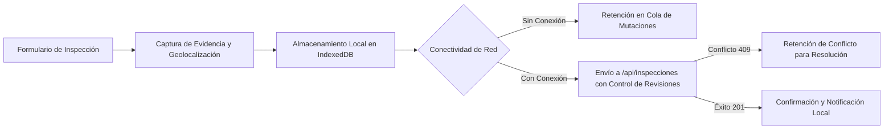

# Estrategia de Pruebas y Aseguramiento de Calidad (Test Strategy)

## 1. Propósito y Alcance

Este documento establece la estrategia formal de pruebas automatizadas para la Progressive Web App (PWA) de **Inspecciones y Mantenimiento de Laboratorios** de la Universidad Tecnológica de Tehuacán.

El objetivo principal es asegurar la confiabilidad, reproducibilidad y estabilidad del flujo crítico de la aplicación en condiciones de conectividad intermitente o nula, garantizando que tanto la lógica de negocio, las capacidades de hardware del dispositivo y la sincronización con el servidor se mantengan libres de regresiones.

---

## 2. Definición del Comportamiento Crítico (*Critical Path*)

El flujo crítico del sistema se define como:



1. **Captura local tolerante a fallos:** El usuario registra una inspección sintética con evidencia fotográfica y coordenadas.
2. **Persistencia offline:** En ausencia de conectividad, la mutación se encola de forma determinista en IndexedDB (`mutations` store) con estado `pending`.
3. **Sincronización atómica:** Al restablecerse la red, la cola vacía las mutaciones en orden FIFO contra el endpoint `/api/inspecciones`, validando revisiones mediante bloqueo optimista (*optimistic locking*).
4. **Respuesta observable y fallback:** Ante caídas de red, falta de permisos o APIs no soportadas, la aplicación responde con degradación agraciada (*graceful degradation*) sin bloquear la interfaz ni corromper los datos.

---

## 3. Pirámide de Pruebas (*Test Pyramid*)

La suite de pruebas adopta la estructura clásica de la pirámide de testing para maximizar la velocidad de ejecución y la cobertura de casos borde sin incurrir en pruebas frágiles o costosas de mantener.

```
          / \
         /   \       Nivel 3: Pruebas E2E (tests/e2e/)
        / E2E \      - Simulación completa de usuario
       /-------\     - Transición online/offline en UI
      /  Integ  \    Nivel 2: Pruebas de Integración (tests/integration/)
     /           \   - Cola + IndexedDB + API endpoint + Conflictos
    /-------------\
   /  Unitarias    \ Nivel 1: Pruebas Unitarias (tests/unit/)
  /                 \- Reglas de dominio, validaciones, fallbacks y esquemas
 /-------------------\
```

### 3.1. Nivel 1: Pruebas Unitarias (`tests/unit/`)
* **Ubicación:** `tests/unit/`
* **Herramienta:** Vitest (entorno `node`).
* **Objetivo:** Verificar funciones puras, validación de esquemas, políticas de conflicto y fallbacks de hardware de manera aislada y ultrarrápida (< 500 ms).
* **Suites implementadas:**
  1. `inspections-domain.spec.ts`: Validación de formato de ID (`isValidInspectionId`), ordenamiento cronológico inmutable, simulación de retrasos y fallos controlados (`listInspections`, `getInspectionById`).
  2. `conflict-policy.spec.ts`: Matriz completa de decisiones de conflicto (`decideConflict`) para el bloqueo optimista basado en revisiones base vs servidor.
  3. `storage-schema.spec.ts`: Ciclo de vida de `MutationStorage` usando `fake-indexeddb`, verificando inserción, idempotencia ante IDs duplicados, actualización (`put`), eliminación y manejo en SSR.
  4. `device-capabilities.spec.ts`: Mecanismos de fallback sintético para Cámara y Geolocalización, liberación de recursos (`track.stop()`) y mitigación de permisos denegados.
  5. `notifications-client.spec.ts`: Detección de soporte, solicitud de permisos y emisión condicional de notificaciones locales.

### 3.2. Nivel 2: Pruebas de Integración (`tests/integration/`)
* **Ubicación:** `tests/integration/`
* **Objetivo:** Probar la interacción entre subsistemas acoplados:
  * Sincronización en cola (`createSyncQueue`) con persistencia en `IndexedDB`.
  * Endpoint HTTP `/api/inspecciones` recibiendo mutaciones con control de revisiones concurrentes.
  * Preservación del estado `pending` ante caídas de transporte simuladas.

### 3.3. Nivel 3: Pruebas End-to-End (`tests/e2e/`)
* **Ubicación:** `tests/e2e/`
* **Objetivo:** Validación del flujo crítico completo desde la perspectiva del operador del laboratorio, simulando el ciclo: formulario -> captura offline -> visualización de resumen -> sincronización y notificación.

---

## 4. Política de Datos Sintéticos y Privacidad

Para cumplir con las directrices académicas y de seguridad industrial:
* **Zero PII (Personally Identifiable Information):** No se utilizan nombres, credenciales, correos ni datos de personas reales.
* **Coordenadas Sintéticas:** La geolocalización fallback utiliza coordenadas fijas institucionales de la UTT (`18.4627, -97.3928`).
* **Medios Sintéticos:** La cámara fallback genera un píxel transparente en formato base64 (`data:image/png;base64,...`), eliminando la necesidad de archivos pesados o captura de rostros reales.
* **Determinismo:** Todos los IDs de inspecciones sintéticas de prueba siguen el estándar `synthetic-[uuid]` o `inspection-00X`.

---

## 5. Fronteras de Aislamiento y Estrategia de Mocking

| API / Dependencia | Estrategia de Aislamiento | Justificación Técnica |
| :--- | :--- | :--- |
| **IndexedDB** | `fake-indexeddb` en memoria | Permite ejecutar pruebas en entorno Node sin levantar un navegador headless, garantizando velocidad y paralelismo limpio sin dejar residuos en disco. |
| **MediaDevices (`getUserMedia`)** | Mock de `stream` con espías en `track.stop()` | Evita requerir hardware de cámara en runners de CI; permite verificar que los recursos se liberen inmediatamente. |
| **Geolocation** | Stub de `navigator.geolocation` | Simula tanto la respuesta instantánea como los errores de timeout y denegación de permisos sin depender de GPS real. |
| **Notification API** | Mock de clase constructora `Notification` | Verifica que no se lancen notificaciones sin permiso explícito (`granted`) y previene errores en entornos no soportados. |
| **Lógica de Dominio y Políticas** | **Sin Mocks (Código Real)** | Las funciones de resolución de conflictos, ordenamiento y validaciones se ejecutan con su implementación real para asegurar detección genuina de regresiones. |

---

## 6. Trade-offs y Decisiones Técnicas

1. **Vitest en entorno `node` vs `jsdom`:**
   * *Decisión:* Ejecutar la suite unitaria con `environment: "node"` e inyectar selectivamente stubs/mocks donde se requieran APIs globales del navegador.
   * *Trade-off:* Menor fidelidad al DOM global completo, pero ganancia masiva en velocidad de ejecución (de ~3-5 s a < 1.5 s para > 100 pruebas) y menor consumo de memoria en CI.
2. **Fallbacks deterministas en lugar de lanzar excepciones:**
   * *Decisión:* Las funciones `captureImage` y `getCurrentLocation` retornan objetos de resultado con bandera `success: true/false` y fallback a datos sintéticos cuando `useSynthetic` está activo o la API está ausente.
   * *Trade-off:* La aplicación no explota ante navegadores antiguos o entornos HTTP inseguros, a costa de requerir que el llamador verifique el resultado si necesita forzar hardware real.
3. **Bloqueo optimista basado en revisiones:**
   * *Decisión:* Control de revisiones atómico (`baseRevision === serverRevision`) en el endpoint `/api/inspecciones`.
   * *Trade-off:* Si dos operadores editan simultáneamente la misma inspección offline, el segundo en sincronizar recibirá un conflicto 409 que debe resolverse de forma asistida, preservando la integridad de datos sobre la sobreescritura ciega (*last-write-wins*).

---

## 7. Prevención de Pruebas Frágiles (*Flakiness*)

* **Cero temporizadores arbitrarios (`sleep`):** No se utilizan llamadas a `sleep` prolongadas; los retrasos simulados en repositorios usan promesas con tiempos mínimos controlados (10-15 ms).
* **Limpieza de estado (`afterEach`):** Todo mock global (`vi.stubGlobal`, `vi.restoreAllMocks`) se restaura al finalizar cada prueba para evitar contaminación cruzada entre suites.
* **Instancias de almacenamiento efímeras:** Cada prueba de base de datos instancia una nueva `IDBFactory`, asegurando que no existan mutaciones residuales entre pruebas consecutivas.

---

## 8. Comandos de Verificación

```bash
# 1. Ejecutar la suite completa de pruebas (Unitarias + Integración)
npm test

# 2. Ejecutar únicamente la suite de pruebas unitarias
npx vitest run tests/unit

# 3. Compilar la aplicación para verificar tipos y build de producción
npm run build

# 4. Verificar existencia de artefactos obligatorios
npm run verify
```
